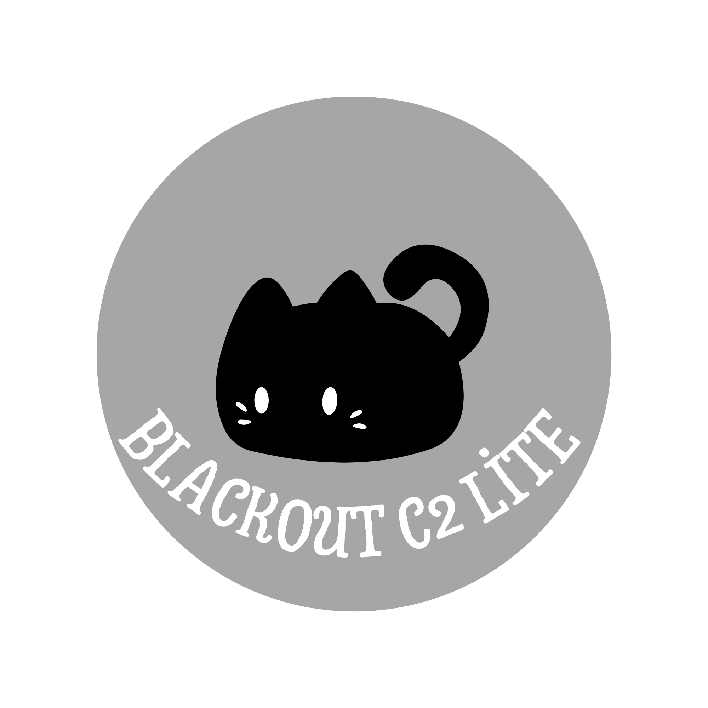

### Blackout C2 LİTE

 “Lightweight, simple, and fast”—these are our core motivations in developing Blackout C2 Lite. Blackout C2 Lite is a next-generation C2 framework that you can use in red teaming and CTF activities. It is highly customizable. 

## Badges

Add badges from somewhere like: [shields.io](https://shields.io/)

  
